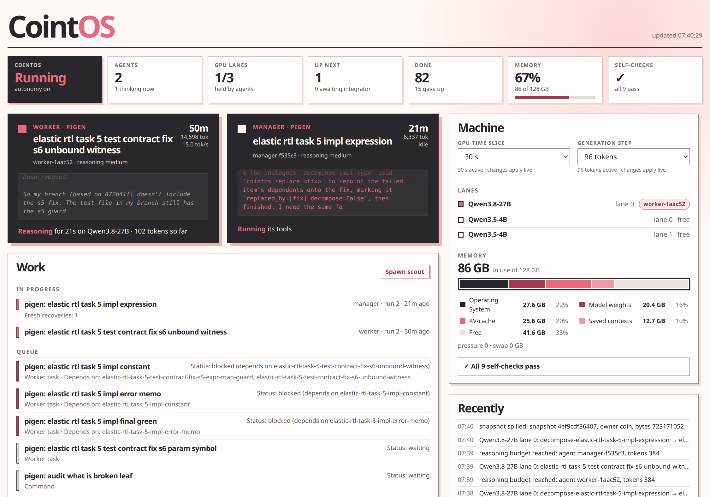

# CointOS

**An operating system for local AI agents.** CointOS runs a small team of autonomous coding
agents on a single workstation using local models. An independent startup repair service
uses the installed Codex CLI's remote provider when the daemon cannot start.
It treats the GPU the way a kernel
treats a CPU: more agents than the hardware can serve at once take turns on pre-emptible model
lanes, while their conversations, context caches and work survive being paused, swapped out,
or even having the daemon replaced underneath them.



## What it does

- **Explains decisions in plain Australian English.** Coin checks current task records and
  explains the code, failure, responsible role and next action before asking you to choose.
- **Schedules GPU time like CPU time.** A thought advances in bounded steps; between steps a
  higher-priority conversation (a chat with you) pre-empts background work, and equal agents
  share lanes by time slice. Saved KV-cache snapshots make switching back cheap.
- **Runs a software pipeline, not a chatbot.** Managers break work into small staged items;
  workers write adversarial test contracts first, then implementations on isolated branches;
  integrators review and land through a gate that re-runs the protected tests on the exact
  candidate. Stewards, test auditors and gardeners keep the projects and their knowledge honest.
- **Owns every lifecycle.** An agent run only ends by submitting one receipt the daemon checks
  against real artifacts. Crashes, budget exhaustion and restarts are recovered deliberately,
  with bounded retries instead of loops.
- **Stays inside a memory budget.** On unified-memory machines, a guard sheds cache, then
  background agents, then the work model before the desktop suffers.
- **Deeply integrated with [knowledgetrees](https://github.com/linkin-parks-bassist/knowledgetrees).**
  Every project, the
  CointOS source and the installed runtime each keep a tree of short, current answers (orientation,
  spec, plan, what is broken). Agents orient from them, managers keep the plan's frontier honest in
  them, integrators update them as work lands, the runtime publishes its live queues into one, and
  gardeners and tree auditors keep them verified.
- **Tells you what is going on.** A live dashboard, a CLI, and a Telegram assistant ("Coin")
  over the same control API. Coin saves each allowed request and Telegram cursor atomically,
  and reloads pending requests after interruption. All Telegram replies come from the model,
  including acknowledgements and `/status`; no canned receipts or error replies are sent.
  Replies enter conversation history after Telegram accepts them, so failed sends stay
  unanswered on retry. Interrupted or partly delivered replies may still repeat.
  Photos and file attachments (including albums and captions) are retained and downloaded
  to `~/.CointOS/state/coin/attachments/`. Captionless attachments are handled by a
  filesystem worker without model turns.
  Ask “Copy incoming photos to ~/Pictures/Trip” to establish a durable rule until
  you change or stop it. Batches flow as they arrive, without expected-total quotas
  or repeated counting. Text and captions still reach Coin. General filesystem tools
  also support one-call batch copy/move, with ordinary verification by default.
  Saved files survive failed replies and replay without resurrecting already moved files.
  Coin operates the workstation through Bash commands and file tools. `run_command`
  returns exit status, stdout and stderr, with optional working directory and timeout.
  Use `kt` to maintain knowledge and the API to manage running work.
  Attachments are stored without image understanding or audio transcription.
  Coin can save internal wakes for deadlines, task states, logical service states or an exact
  process ending. Deadlines accept relative delays or offset-aware timestamps.
  Its service reloads the disk registry after reboot; missed deadlines remain
  due, while interrupted processes have unknown results. Ordinary wakes bring up the model at background
  priority; work explanations and requested-work completion updates use Coin priority.
  Routine mistakes and recoverable failures stay local. Unfixable problems and concrete workflow improvements queue durable model explanations without canned placeholders. Sizeable requested jobs get completion and significant usable-milestone updates with result locations; conversational dispatches are tracked durably. Coin uses its own `KT_ACTOR` identity
  for knowledge access across registered trees, rather than a grant to its working folder.
  It avoids engagement questions; genuinely consequential decisions get contextual options and a recommendation. Routine engineering choices take the recommendation without stopping.
  Conversation history grows to `coin.history_messages` (20), then discards the oldest
  `coin.history_trim_messages` (7), leaving 13. Text/captions and delivered replies count;
  captionless attachments do not enter conversation history;
  the on-disk archive stays intact. A separate native history-prefix checkpoint allows
  growing history to reuse cached state despite changing clocks and tool context.
  Unfinished instructions can be retained independently with `retain_request`; they stay
  in later turns until verified completion or cancellation via `finish_request`.

## Requirements

CointOS is a personal system built for one machine and is shared as-is. It expects:

- Linux with systemd user services and Python 3.
- The native [Gufo](https://github.com/gufo-org/gufo) bridge serving Qwen3.8-27B
  UD-Q4_K_XL for Coin and construction on one shared 131k lane. The reference
  setup is a 128 GB unified-memory AMD workstation. Gufo uses DFlash2 with a
  Q4_K_M draft and adaptive block width. The optional [Lemonade](https://github.com/lemonade-sdk/lemonade)
  / llama.cpp adapter supports other configured models.
- [OpenCode](https://opencode.ai) as the agent harness.
- [knowledgetrees](https://github.com/linkin-parks-bassist/knowledgetrees) (`kt` and its MCP
  server), which agents use for orientation, specs, plans and runtime state.

Model names, lanes, memory sizes and paths live in `config/cointos.json`.
`work_model` selects the agents' model; `coin.model` selects Coin's model from `models`.
The per-model dispatcher `cointos.backend_native` selects Gufo for Qwen and defaults
other models to llama.cpp. Build the pinned native bridge in `patches/gufo` with
`scripts/build-gufo-control --source GUFO_CHECKOUT --package DEST --runtime-library-dir SDK_LIB`.
The Qwen `gufo` configuration names the launcher, weights, private socket and weight
SHA256; paths must match the local package and SDK. Its `dflash` object names the
draft `model_path` and `sha256`, with `max_draft_tokens` (1–7, default 7) and
`policy` (`adaptive` or `fixed`, default `adaptive`). Omit it for autoregressive
decoding. Both weights and draft settings bind native snapshot identity.
Live Gufo steps expose draft proposals/acceptances, native time, context and effective
sampling in ledger `thoughts[*].decode`. Agent/Coin `speculation` counters aggregate
only measured steps with their own output-token/time totals; agent-ended events retain
the aggregate. The dashboard leads with one-pole exponential moving averages: generation tok/s, uncached prefill tok/s, and accepted/proposed draft-token percentage (MTP). Each filter has a 10-second active-time constant and advances only during its own phase; prefill, idle and tools cannot dilute generation speed. MTP smooths matching acceptance/proposal rates during speculative generation. Unmeasured fields show a dash; inactive fields hold their values and daemon restart resets the filters. The same values appear in ledger/live `performance`.
Completed `switch` events separate `save_seconds`, `transfer_seconds` (cache readiness
and disk-to-RAM transfer), and native `restore_seconds` from `seconds` through
the ledger update before final event logging.
Transfer/restore durations include all attempted compatible candidates.
`restore_tier` records the last attempted cache's tier; following prefill is separate.
Native DFlash2 continuation, tools, reasoning-budget closure and snapshot restore
at 130,944 tokens have been qualified. Gufo launches in an independent systemd
user scope so compatible daemon replacement can retain the model process.
Persistent restores reattach the runner's request-local prefix index before prompt
extension and reuse the physical executor after clearing its transient state. Exact
continuations preserve learned draft length; starting a new request is separate from
consuming a chunk's pending token or restoring its saved continuation.
The scheduler uses each backend's continuation contract: Gufo can decode directly
from its complete held token vector, while llama.cpp requires a strict extension.
Qualification checks that path, repeated restores and restored decoding. During a
model replacement, warm restored state and let host memory pressure settle before
the daemon adopts it and resumes clients.

## Install and replace

This repository is the source; `scripts/install` copies the runtime into `~/.CointOS/`,
renders the systemd user units (`cointosd`, `cointos-coin`, `cointos-repair`) and links `~/.local/bin/cointos`.
Installed `config/projects.json` is user-managed and preserved across upgrades.
Installation renders service files and checks ledger, keys and enrollment before stopping
services or copying code. Independent repair requires an authenticated installed Codex CLI.
Startup reads these as regular, non-symlink JSON files; damage or unreadability refuses
startup without replacing them with empty state. Only genuine absence initializes defaults.

- **Full install** (first install, or model/gateway/backend identity changes): `cointos stop`,
  wait until `cointos agents` shows none, run `scripts/install`, then `cointos up`, check with
  `cointos check`, and resume autonomy with `cointos go`.
- **Live install** (code, prompts and daemon-policy config such as reasoning, recovery,
  scheduling and spawning): `scripts/install --live`. When daemon code changes, only
  cointosd is replaced; shutdown saves lane state and cuts replies, which OpenCode retries. Running agent
  units are adopted without relaunch. Incompatible changes are refused before anything
  is touched. If daemon code/configuration is unchanged and dependency aliases need no migration, only
  prompts, dashboard, CLI and runtime guidance refresh without restarting the daemon.
  CLI modules are published atomically; running MCP and Coin processes retain their
  imported code until those processes refresh. Stored same-project dependency aliases are migrated while
  the daemon is stopped, preserving assignment versions, holds, sessions and receipts;
  conflicting or foreign dependency metadata refuses installation before changes.
- **Live settings:** GPU time slice and generation step (`scheduler.slice_seconds`,
  `scheduler.chunk_tokens`) change from the dashboard or `POST /api/scheduler` and apply
  at the next GPU step. Other settings need a live install.
- **Coin changes:** copied Coin code and startup settings take effect after a quiet
  Coin-only restart; live installation preserves its running process. Confirm no pending
  conversation work before restarting `cointos-coin.service`.
- **Dashboard-only changes:** the daemon reads `web/dashboard.html` on every request, so
  copying that file into `~/.CointOS/web/` is enough.

See `kt how to install cointos` and `kt how to restart cointos`.

## Projects and queues

Enrollment lives in `config/projects.json`, separate from `config/cointos.json`.

```
cointos project new NAME            # create ~/Projects/NAME with Git and a knowledge tree
cointos project add PATH            # register an existing repository
cointos project set NAME --priority N --enable|--disable
cointos project list
cointos queue PROJECT NAME "BRIEF" --kind queued|urgent|command
cointos task PROJECT:ITEM           # current assignment, dependencies and receipts
```

Lower priority numbers run first within a class. Each project owns its orientation, spec,
plan and broken leaves. The installed runtime publishes a globally readable knowledge tree
describing operation and the daemon-owned queues.
Project changes are saved before they take effect in the daemon; a failed registry write
leaves enrollment unchanged.
New repositories include the configured `project_defaults.test_policy`: by default,
`tests/contracts.json`, protected `tests/**` and `Makefile`, and non-code `.knowledge/**`
and Markdown files. Custom policy flags override it. Imported repositories need a configured
test policy before workers can land; production changes require accepted coverage.

Coin (Telegram) exposes the same project operations and can launch a bounded ad-hoc operator
(`run_agent`; CLI `cointos agent run NAME BRIEF [--project P] [--reasoning-effort E]
[--ability standard|control|network]...`). Abilities change real tool permissions; none
grants sudo, package installation, Git push. Control permits user-service operations.
New worker, manager, integrator, gardener, tree-auditor and project Operator servers inherit a Landlock write boundary: product writes stay in their assigned checkout, including shell writes. The launcher registers each existing checkout knowledge tree before confinement, so authors can create answers without writing global access policy. Registration grants no cross-project access. Required Git/tool/scratch state and authorized project knowledge maintenance remain available. Unsupported kernels refuse these launches; adopted servers retain their launch policy. Branch-publishing roles are selected from schema.KINDS. Project Operators read preserved worker artifacts and hand back through queue controls; they cannot directly write another checkout through their confined process tree. Explicit system infrastructure Operators retain their separate scope.

Every new agent run receives its own mode-0700 scratch directory through `COINTOS_SCRATCH`
and `TMPDIR`. Agents create fresh probe/build directories there and preserve pre-existing
paths on collision. Scratch stays with run evidence; this convention does not isolate
hardcoded shared temporary paths. Existing processes retain their launch environment.


## Roles

- **Managers** plan one coherent behavior boundary, keep the project plan's remaining frontier
  honest and atomically dispatch children with `cointos_handoff`. They change queued work with `cointos hold` then `cointos revise`.
- **Workers** implement one `skeleton`, `test-contract`, `implementation` or `integration` item
  on an isolated branch and submit an exact commit; their receipt is their account of it.
- **Integrators** review a worker against main and its contracts, maintain the project tree and
  land through the daemon's exact-candidate gate (`cointos land|incorporate|return`).
- **Stewards** periodically roam the runtime and projects for concrete loose ends and may queue
  one manager command; they never implement. Cadence is a six-hour baseline multiplied by one
  plus the active/queued concern count. **Spawn scout** on the dashboard schedules one now.
- **Test auditors** (medium reasoning) sample a recent landing, compare its tests with the spec
  and raise at most one manager command for a real coverage gap.
- **Gardeners** verify a small batch of knowledge leaves per tree; **tree auditors** check one
  structural concern across a sample.
- **Operators** own recovery directly, one per assignment/version, or carry an ad-hoc assignment started by the owner or a non-worker agent
  for work the pipeline has no route for, paid from that agent's own run budget.

Every run ends with exactly one receipt the daemon checks against its artifacts:
`cointos finish --complete "evidence"` or `--blocked "reason"`; an integrator's verified
land/incorporate/return is its receipt. Manager handoff and recovery replace/correct-tests record their
handoff and complete receipt together. CLI output and MCP protocol replies flush before
acknowledging delivery and retiring the run. Process exit, finish markers and final text never
complete a task. `cointos message user "TEXT"` (or the agents' `cointos_send` to `user`) records
a durable user-directed message from any run. Coin retries Telegram delivery and acknowledges
transport acceptance; dashboard reads never count as delivery. Pending questions survive history
trimming. Ownerless, unheld blocked work escalates after coin.blocked_notify_seconds (60),
while active recovery and valid continuations suppress escalation. Routine warnings stay local.
Telegram/network failure remains retryable; a crash after acceptance can duplicate a message. The model-independent notice is brief; Coin uses a durable turn to explain the context and consequences rather than forwarding internal reports. All accepted outgoing parts join the same rolling history as incoming text/captions. Reply-to references survive rollover, and answers can use the normal scoped controls after checking current state.
Routine test-layer, sequencing and implementation choices belong to engineering recovery,
with every product obligation retained in the plan; they do not require a user decision.

Steward completion also supplies `scout_result` through the typed finish tool (CLI:
`--scout-result-json`). `manager_handoff` requires the exact runnable command queued by
that steward; a user alert cannot substitute for it. `no_action` names every enabled
project in `checked_projects` after `cointos_check_work` supplies the current accepted
plans, queues and recent acceptances. Changed frontiers require another review. `user_decision` names
a specific new question needing personal authority, rather than managerial planning of
approved work. The daemon checks declared queue authority/state, not semantic judgment.

Construction completion requires a changed committed artifact relative to its assigned baseline; empty commits and read-only inspection cannot create review work. Already-authored artifacts on main remain eligible for checked incorporation. Inspection/status belongs to planning or a scoped Operator.

Maintenance merge cannot replace product review. Managers and tree maintenance publish
Markdown knowledge; project Operators may also publish configured non-code maintenance.
Production and protected tests/harnesses require worker submission and independent review.
Protected paths override non-code patterns. The daemon checks every unpublished commit,
including reverted diagnostics, while preserving inherited accepted main history. Explicitly
assigned system infrastructure work retains its separate scope.
Maintenance preflight also reports forbidden staged, unstaged and untracked paths
before they enter commit history, preserving the checkout and index.
Knowledge maintenance defers answers with pending canonical body or policy edits.
Health repairs also stay within the committed, available inventory; unavailable leaves
are reported instead of producing phantom or empty tasks. Publication rechecks overlaps
with canonical files and staging. Lifecycle status/timestamps alone do not block repair. Clean editor branches remain independent of accepted main. A gardener cannot complete against selected pending canonical answers, even without branch changes; it preserves its commit and reports blocked.
Unstarted recovery for that garden waits for the selected canonical answers to become
available, rather than spending a repair allowance on another session's drafts. Current
health refresh restores eligibility; unknown health does not suppress recovery, and
started controllers retain their context and allowance.

For a clean committed worker packet, three refused submissions with unchanged candidate
content and acceptance inputs produce a checked blocked receipt and direct Operator recovery.
The branch survives. Empty commits do not reset the count; actual changed inputs do.
The terminal command reports the real receipt disposition. This bounds repeated packet
validation errors; dirty/no-artifact preflight and integrator refusals remain separate.

Before a construction run stops with plain text, the gateway requests one declared
`cointos_check_work` call in the same conversation. It reports broken handoffs and dirty
worker/manager artifacts. Worker checks name uncommitted files outside the assigned stage,
including staged edits, deletions and untracked files. Preserve diagnostics separately and
restore those files before committing the scoped artifact. Integrator preflight compares the staged/unstaged review worktree with main plus the
submitted packet, including untracked protected files and production edits in test-packet
reviews. Faithful staging is valid before commit; HEAD and the index stay unchanged. The result is
structured tool data, with validation failures marked as tool errors. A green preflight
still needs the role's completion receipt and independent semantic review.

Construction assignments identify the active checkout first. Product reads use it or
accepted Git refs; read/external-directory tool rules reject the stale editor checkout,
while retaining knowledge, Git metadata and project instructions. Shell reads have no
kernel isolation. Existing servers keep their launch permissions.

Planning merges go through the daemon's current run authority and permit only knowledge-tree
changes. A manager cannot publish product code, tests or build files through `cointos merge`.
Successful Coin sends log Telegram message IDs and hashed report/chat correlation in the
service journal. Saved model history does not establish delivery or that the user saw it.

Run admission reserves each directory exclusively and gates follower launch behind the ledger
lock until its key and ownership are established. Thread/key failures preserve waiting work;
unreadable, malformed, ambiguous or nonregular key registries cannot erase existing identities. Keys
resample collisions; adoption preserves one owner and permits exact retries. Adoption follows
exact task or current receipt ownership, preserving sessions and requeueing displaced tasks.

Failed systemd status queries keep the observer following the run; only a confirmed
terminal unit permits exit reconciliation. Run server/exit metadata publishes atomically; the observer tolerates malformed event fields and keeps valid recovery evidence. Failed metadata writes still run server cleanup. OpenCode error events remain retry diagnostics.

A reasoning-only or empty non-length model reply is an incomplete response, not a successful
assistant stop. The gateway returns `incomplete_response` (JSON HTTP 502 or streaming server
error) after any existing construction pre-stop check. Native OpenCode can retry within the
same run; token-limit replies retain `length` continuation. Existing budgets and receipt
authority remain unchanged.

## Tests as contracts

Code travels with its tests. A test-contract worker writes a behavior's tests from its contract
and registers their command in the project's manifest (normally `tests/contracts.json`).
Implementation and integration assignments under a test policy must depend on an accepted
test-contract item. A packet named only in prose is not binding. Submission refuses an empty
binding; landing and incorporation require the receipt's packet commits to match the current
accepted dependencies, and code lands with those tests.
Witnesses must reach the tested boundary, frozen assertions must remain valid after
implementation, and rollback comparisons must capture state before the failing call. When the
writer finishes, the daemon runs the suite on main with the tests merged in: tests that already
pass land after review; failing ones become a hidden packet only after independent integrator
review of the contract and witness inputs. Writer completion alone does not satisfy the
implementation dependency. The exact reviewed candidate runs before acceptance; timeouts
and invalid execution cannot authorize hidden acceptance. That implementer's finish runs the packet and reveals only failing
tests. Concurrent insertions in protected test files retain a whole block once when already
present; otherwise current-side blocks precede packet blocks. Repeating review preserves the candidate;
conflicting replacements still need review. Completion, review and landing use this same composition.

Validation has separate clocks: `timeouts.command_seconds` bounds one command after its
output lease is acquired (five minutes by default); `timeouts.validation_seconds` bounds
the complete validation, including lease waits (thirty minutes). CLI and MCP deadlines
allow that full operation. Timeouts, killed processes and failed execution units are
infrastructure errors, not red-test evidence. Repeated unchanged execution failures escalate
separately from product refusals to the recovery controller.

The integrator lands code and tests together after the daemon runs every registered
command on the exact candidate; a test green on main that the candidate breaks returns the item
with that test added to its packet. Implementation commits cannot change protected tests or
harnesses. Stage checks exclude commits already on main, so importing landed prerequisites
does not count as worker edits. Work finished blocked cannot land: it must be submitted complete
and pass its stage's checks first. A queue
item is done only through a verified acceptance. A blocked worker goes directly to one
recovery Operator, which verifies its evidence and repairs the assignment or hands off
an independent test correction.

The returned acceptance distinguishes hidden test review (`via=tests`, not published) from
publication (`via=landing`). It retains the measured `gate`: `suite` commands, `failed` on the
candidate, and `red_on_main` also failing on prior main. These counts persist in receipts,
queue acceptance and publication intents/recovery. CLI prints the distinction and failures;
a permitted landing with pre-existing failures is not a wholly green suite. Historical
acceptances without retained measurements remain unknown.

Publication advances the accepted main ref atomically. A dirty main checkout keeps its
files and staging on a draft branch; a clean checkout refreshes. Switched workspaces
remain independent. Repository contention returns immediately; CointOS mechanical Git
commands bypass hooks without changing ordinary editor Git. Before publication the daemon persists a verified intent pinned to
the receipt and assignment version. After a crash, a published intent settles before surviving units are adopted or their
budgets enforced, without another model review or the old worktree. Holds and stale runs revoke validation
results before either acceptance or failed-test bundling. Test commands share a process-owned
lock for host temporary outputs, retained by surviving test units after daemon death;
unrelated external builds remain outside it. Test harnesses must build and execute
artifacts in fresh invocation-owned directories with cleanup; fixed host temporary
executables can produce false passes when another build overwrites them.

Run `python3 -m tests.pipeline_simulator --cases 200000 --seed 712109 --output /tmp/pipeline.json`
to fuzz production lifecycle, queue, admission and landing functions against simulated Git,
tests, durable writes and crashes. Failures retain seeds, traces and reduced fault combinations;
replay with `--cases 1 --seed SEED --fault FAULT` (repeat `--fault` for a combination).
Real Git publication and crash-recovery checks are in `tests.test_publication` and
`tests.test_landing`. Simulation covers the declared fault model, not every possible agent error.

`cointos cancel PROJECT:ITEM... --reason WHY` withdraws unaccepted work for good: it stops any run on
it, drops the queue records and retires their branches. Live dependents must be cancelled with it.

Every worker brief an agent queues or revises carries a `Summary:` line of 5-20 plain words saying
what the task is for; the dashboard shows it beside the task, and the API refuses a brief without one.
`Depends on:` accepts comma-separated item names or same-project `PROJECT:ITEM` IDs.
Creation and revision store local names in both the brief and graph, deduplicating aliases;
another project's IDs are refused before changing the assignment. Local forward references
remain possible, so managers must check that prerequisites are actually queued.

Test-contract work is checked mechanically too. Its brief must name the existing owner APIs it
relies on (`Relies on: name, ...`; names, `path::name` citations or file paths; prose periods
and semicolons are ignored); once its dependencies land,
the daemon checks that each name exists somewhere on main and sends an infeasible brief straight to its recovery controller before any worker runs.
`cointos metrics [--hours N]` reports landings by stage, gate returns, infeasible briefs and
recovery controllers, legacy manager passes and recorded generation use from the event journal.
`cointos jobs` shows every unfinished task plus recent terminal history; `--project PROJECT`
filters before selecting history. `cointos task PROJECT:TASK` shows the current queue assignment,
binding accepted test packets, actual correction owners, receipts and holds. The canonical brief
and checked receipt appear once. Recovery launches use the same current view.
`task PROJECT:TASK --history` retrieves complete execution records;
old recovery briefs and ordinary packets claiming replacement do not change acceptance authority.
`jobs --all` includes older tasks without expanding every report. New queue items cannot
claim IDs already owned by tasks; identical proposal retries and assignment revisions
retain their existing identities.

## Reasoning and budgets

Reasoning effort is `low`, `medium` or `xhigh`, capped per uninterrupted reasoning block at
256 / 384 / 1,024 tokens (`reasoning.budgets`), after which the reply continues into its answer
or tool call. Interrupted reasoning keeps the tokens already spent against that cap.
Defaults: low globally; medium for test writers, managers and integrators. Effort is
pinned when a task is created; `cointos reasoning PROJECT:TASK EFFORT` changes an existing task
from its next reply, and explicit overrides always win.
Coin also sends the configured default effort on its model requests, so deep tool turns
receive the same reasoning cap.

The common run allowance is configured in `recovery.generation_seconds` and
`recovery.generation_tokens`; manager and Operator defaults have no shorter overrides.
Reasoning counts; lane wait, prefill and tools do not. Override with
`--generation-seconds`/`--generation-tokens` on `cointos queue`, or use
`cointos budget PROJECT:TASK ...` for waiting work and explicit increases to live runs.
Live decreases are refused; existing spend, grants, sessions and artifacts remain.
The run budget is the only per-run work limit; long silent work does
not trigger an earlier artifact checkpoint.

## Recovery

- Ordinary death or daemon restart resumes the same OpenCode session. Under three hours,
  an unfinished turn reuses its original user message through a one-shot OpenCode hook,
  preserving its ID, timestamp and parts; completed replies get `Continue.`. Longer gaps
  get one concise reorientation. First, the supervisor completes any interrupted compaction
  through OpenCode's native summarize API.
  A failed summary withholds the turn, preserving the history boundary.
- New managed OpenCode launches attach a bounded task/checkout snapshot to native
  compaction summaries. It distinguishes accepted test bindings from the local manifest
  and reports remaining budget including grants. Unavailable facts stay explicit.
  This does not verify the model's prose; agents re-read current task authority and inspect
  local files before acting. Existing servers retain their loaded plugin and environment.
- OpenCode 1.18.35 needs the [attached-event drain fix](patches/opencode-1.18.35-attach-events.patch)
  to deliver reply events before its CLI exits. The fingerprint-guarded
  `python3 scripts/patch-opencode-attach-events INPUT NEW_OUTPUT` creates a patched copy
  of the inspected executable; it refuses unknown builds and never overwrites the input.
- Budget exhaustion preserves the branch, files and a 6,000-character packet of recent
  outward text, tool actions and Git state. Workers, managers, integrators and Operators
  default to zero fresh budget retries: a failed worker reaches its recovery controller instead of
  automatically receiving another full allowance. Other roles use their configured retry
  policy. Hidden reasoning is never copied.
- A process that exits before its first model request is a launch failure: refunded, retried at
  most twice, then held for independent Operator recovery.
- `cointos kill AGENT` stops one run and holds its task until `cointos resume TASK`.
- A failed assignment gets one capable recovery Operator per canonical work version,
  with its assignment, receipt and preserved artifact evidence. Recovery is serial per project;
  unrelated workers continue. There is no intermediate recovery-manager chain.
  Recovery waits while its unheld, unchanged child frontier can progress, including review
  and independent test correction. Dead edges or settled children release that deferral;
  the failed manager remains unaccepted.
  Automatic repair has an independent budget, queue and user-service tools, and a checked
  handback. It checks the reachable prerequisites; an unknown, cyclic or terminally
  blocked prerequisite cannot authorize completion. Adding a missing prerequisite can
  repair an unchanged brief. Withdrawing the origin revokes further repair controls.
  `cointos replace EXISTING...` validates the controller's landed artifacts and unheld
  replacement graph before repointing dependents and recording completion together.
  Exact retries replay the receipt; no duplicate child or separate finish call is needed.
  A recovery controller's `cointos correct-tests` likewise checks and completes its
  handback with the independent correction request; refusal leaves no partial child.
  Managers and ad-hoc Operators use correct-tests nonterminally.
  `supersede` remains available for intermediate graph changes.
  Explicit holds remain respected; cancelled/history incidents and Operators
  do not recursively create repairs.
- Fatal Python daemon failures trigger `cointos-repair.service` outside the local gateway.
  It retains its Codex conversation and checks current health against daemon-produced
  evidence that saved authority and surviving native identities were restored before
  adoption. Authorised later revision, retry and cleanup remain valid. It never writes
  the ledger or keys. Installation and repair share one ownership lease.
  Native retries use `service_restart_seconds`; the repair service has no inherited start cap.
- `cointos supersede`, `cointos incorporate` and `cointos clear-review` repair failed
  prerequisites, settle work already on main and withdraw stale infrastructure feedback.

## Memory

The workstation's 128 GiB unified RAM is one pool. The memory guard sheds snapshots first.
Sustained pressure stops background agents; the work model unloads only if headroom stays
negative after shedding. Saved contexts have a configured RAM budget (`memory.snapshots_gb`)
and spill to a bounded disk tier; a cache miss only
costs re-reading. `state/events.jsonl` plus one rotated file keep bounded diagnostic events
(8 MiB each) without prompts.
Records queue as immutable bytes without filesystem I/O under the state lock, then
flush in order before ledger publication and at shutdown. Journal failures remain
visible in self-checks. An abrupt kill can lose the queued diagnostic tail; task
authority and acknowledgment still require the ordinary ledger publication.

Snapshot admission uses measured sizes from the same model without scaling fixed state
overhead downward for short contexts. Actual save sizes are measured and reconciled.
A replacement can reclaim its old compatible cache when its release can meet the RAM budget
and host headroom, before spilling unrelated work. Required RAM deletion finishes outside the
state lock before saving; pending bytes are never free capacity. If saving fails, that cache is rebuilt by reading again;
task history and authority remain intact. When both copies fit, the old cache stays until success.
Restoration tries compatible prefixes longest first; an unavailable or invalid longer cache
does not hide a shorter usable one.
Longer shared starts retain shorter tiers for other roles. Coin caches are scoped per user;
new turns discard only that history's divergent states while retaining the shared system start.
Caches of terminal tasks are released once no run can resume that conversation, including
workers accepted after their own run ended. Copying finishes before discarded caches are
removed. After daemon replacement, a regular copy matching the recorded byte length survives
an interrupted transfer; native restore still validates it. Missing or partial-only copies
become cold, and discarded or retired owners are not recovered.
Startup inventories abandoned files and copies left in the wrong tier. Independent RAM and
disk workers inspect and delete them outside the state lock; disk deletion never runs on the
model worker. Retirement records survive daemon replacement and retain their tier's budget
charge until physical deletion completes. Active restores pin their files, and transfers and
unpublished saves retain ownership. Failed cleanup remains charged and retries with an
observable error; a failed store inventory gates new allocations in that store. Shutdown can
wait for disk cleanup outside the lock before persisting RAM caches. Conversation history
and branch artifacts are unaffected.

## Dashboard

`http://127.0.0.1:4200`, pictured above. The header carries the run switch (**Pause
everything** / **Resume agents**, the same as `cointos stop` / `cointos go`) and buttons to
**Queue work**, **Run operator** and **Spawn scout**; one strip of tiles follows. Home and
project pages lead with live agent cards (active Coin first), followed by Work: in progress,
waiting for the integrator, up next and queued work, each row with its inline controls
(pause, resume a held task, message, hold, reorder), then **Done** and **Failed** counts that
open their lists. **Messages** lists what agents sent the user, with **Reply** to the sender's
inbox while its task is active; reading there is not delivery. The task drawer offers resume,
pause, message, budget, brief revision, hold and cancel, then queue position and reasoning
effort as segmented choices.
Reversible controls act at once. Cancel, project removal and **Clear finished history** ask
in place instead: the first click arms the button, a second within four seconds runs it.
Failure history includes old and superseded tasks; a failed manager's child work may still
be running. Its count is failed task records, rather than unresolved product defects.
Home shows project cards linking to each project's page, and **Add project** (an existing
repository or a new one). A project page heads with its purpose, branch and repository and
its settings: an **Enabled** switch (disabling stops its agents), priority (High, Normal or
Low: 50, 100 or 200, lower runs first) and **Remove**; its pipeline shows the latest four
landed items. Messages, Machine (GPU controls, viewer-window switch, lanes, memory and
collapsed Diagnostics) and Recently (machine events switched off unless asked) sit beside
the main column.
Diagnostics describe failed checks as problems, link affected work to its drawer and show
the current blocker. Technical details stay folded. Checks do not create additional recovery
attempts or refill exhausted budgets; the normal recovery lifecycle owns corrective work.
Project pages put those panels below the full-width work area. **Clear finished history**
removes terminal records no unfinished work still references. It retains task evidence and
sessions for transitive prerequisites, recovery work and workers of waiting integrators.

The page fetches `/api/ledger` and streams `/api/live` from the address serving the page.
A reverse proxy to another machine shows that machine's runtime; the viewing device
does not need a local CointOS installation. Large JSON/HTML replies support gzip.
Ledger responses capture a consistent snapshot under the daemon lock, then encode and
send it outside that lock so a slow dashboard connection cannot hold up scheduling.
The header distinguishes connection failures from display errors and retries snapshot
requests, with a 30-second timeout.

Brief revisions retain omitted construction stage, reasoning effort and budget limits;
explicit budget changes merge the named limits. Correcting wording must preserve the
test-contract/implementation boundary.
Agent revisions of implementation/integration work cannot drop accepted test-contract
dependencies. Refusal preserves the assignment and run; a build repair must retain its
acceptance tests. Invalid accepted tests use `cointos correct-tests` / `cointos_correct_tests`: a separate author
and reviewer correct the exact accepted packet. Old acceptance stays binding until review,
then dependent implementations resume with their existing code and holds preserved.
Pending corrections are admission prerequisites for consumers, even after a brief revision.
The correction itself remains runnable, and waiting consumer reviews leave the project's
review slot available. Withdrawing a correction removes its admission wait while preserving
the original accepted contract.
Planner, worker and reviewer assignments show the current queue version, binding accepted
tests and typed correction relation. A separately accepted packet cannot complete that correction.
An explicit user revision can withdraw a test dependency, but implementation submission still
requires an accepted contract; removing the last edge does not waive the test gate.
Before implementation submission, existing/shared harness changes, reused command
registrations or packets without new commands run their registered suite, deduplicated
across packets. Distinct new packet commands remain scoped. The manifest describes
production coverage, not test-file ownership; unchanged command names cannot justify
skipping assertions in changed harnesses.
Revisions preserve user and other owners' holds; only the revising task's own hold ends.
User holds require explicit release.
An origin revision by another owner cancels stale recovery controllers while preserving
their files. A recovery controller may finish its own correction.
An existing waiting integrator waits for its worker's fresh review and receives the revised
assignment before resuming.

## Development

The repository's own knowledge tree (`.knowledge/`) is the design record: start with
`kt where am i`, then `what/is/the/architecture/of/cointos.md`, `what/is/the/spec.md` and
`what/is/the/plan.md`. Run the checks with `python3 -m unittest discover`.
Custom runners must import `tests` before any `cointos` module so captured runtime paths
point into disposable state. The suite also isolates caches, generated queue knowledge,
knowledge-root registration and rewrite state. Late isolation is refused. For installed-package replays,
put `~/.CointOS` first on `PYTHONPATH`, use `python3 -P -m unittest` with explicit test
module names, and keep fixture events separate from native acceptance evidence.
